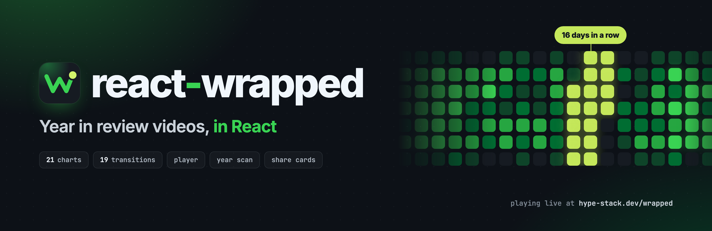
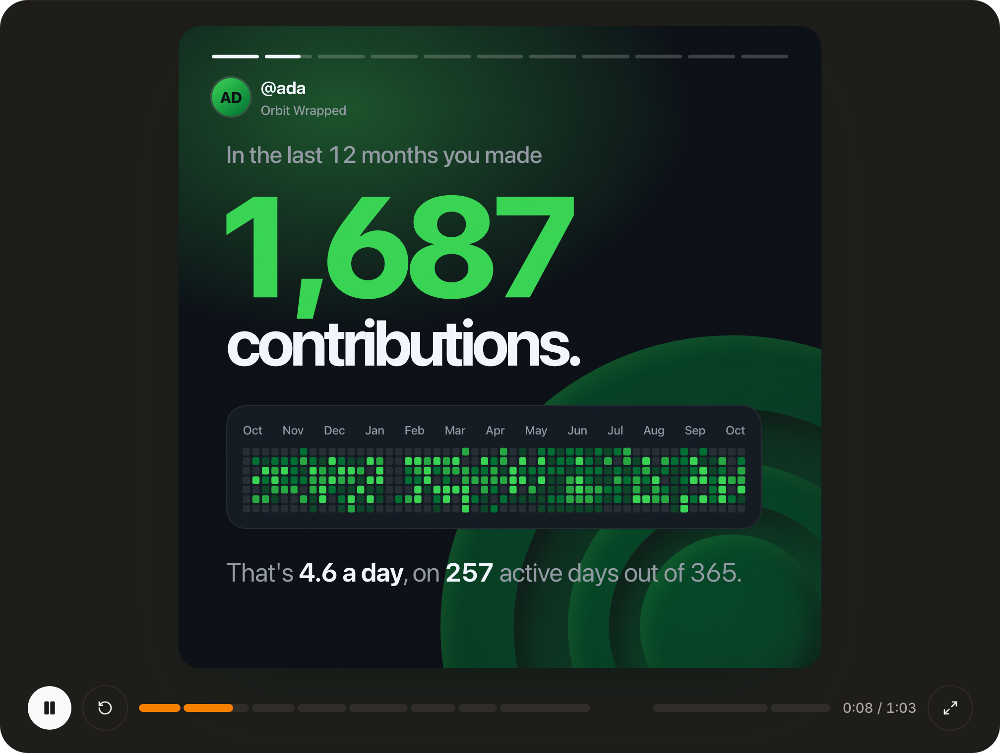

<h1 align="center">

<a href="https://www.hype-stack.dev/wrapped?utm_source=react-wrapped&utm_medium=referral&utm_campaign=readme-top">
  
</a>

</h1>

<div align="center">

**Year in review videos, in React.**

**[See it live on Hype Stack](https://www.hype-stack.dev/wrapped?utm_source=react-wrapped&utm_medium=referral&utm_campaign=readme-top)
| [Docs](https://bettertyped.github.io/react-wrapped/) | [Designs](https://bettertyped.github.io/react-wrapped/designs/)
| [Discord](https://www.hype-stack.dev/discord)**

</div>

<div align="center">
  <a href="https://bettertyped.com/">
    
  </a>
  <a href="https://www.npmjs.com/package/@react-wrapped/kit">
    
  </a>
  <a href="https://github.com/BetterTyped/react-wrapped">
    
  </a>
  <a href="https://github.com/BetterTyped/react-wrapped/blob/main/LICENSE.md">
    
  </a>
  <a href="https://www.npmjs.com/package/@react-wrapped/kit">
    
  </a>
  <a href="https://bundlephobia.com/package/@react-wrapped/kit">
    
  </a>
  <a href="https://github.com/BetterTyped/react-wrapped">
    
  </a>
  <a href="https://x.com/maciej_pyrc">
    
  </a>
</div>

<br />

<p align="center">
  <a href="https://www.hype-stack.dev/discord">
    
  </a>
</p>

<br />

## What it is

react-wrapped turns a year of numbers into a short video that plays in the page. You describe the year as a list of
scenes. The library brings the stage, the animation, the transitions between scenes, a player with a timeline you can
edit, and a button that saves the video as a file. It started as the engine behind
[Hype Stack's Wrapped](https://www.hype-stack.dev/wrapped?utm_source=react-wrapped&utm_medium=referral&utm_campaign=readme),
where it plays real developer years. Use it whole as one component, or take single packages: only the charts, only the
player, only the share cards.

<p align="center">
  <a href="https://www.hype-stack.dev/wrapped?utm_source=react-wrapped&utm_medium=referral&utm_campaign=readme">
    
  </a>
</p>

## Install

```bash
pnpm add @react-wrapped/kit gsap
```

Load the stylesheet once, anywhere in your app:

```tsx
import "@react-wrapped/kit/styles.css";
```

You need React 19 and GSAP 3.13 or newer. The stylesheet brings everything the components use and keeps to its own `wr-`
classes, so there is no Tailwind to set up and no reset to load.

## Quick start

A Wrapped is a subject, a seed and a list of scenes. Each scene is a function you call with its content and a key.

```tsx
import { useState } from "react";
import { bigNumberScene, chartScene, DEFAULT_WRAPPED_CONFIG, summaryScene, WrappedView } from "@react-wrapped/kit";
import "@react-wrapped/kit/styles.css";

const subject = { handle: "ada", name: "Ada", avatarUrl: null, caption: "Orbit Wrapped", period: "2026" };
const weeks = [4, 9, 6, 14, 22, 31, 18, 12, 9, 15, 7, 11];

const scenes = [
  bigNumberScene(
    { eyebrow: "This year", value: 1687, title: ["commits."], lede: "**4.6** a day.", counter: "climb", variant: 0 },
    { key: "total", label: "Total" },
  ),
  chartScene(
    {
      eyebrow: "Your year",
      title: ["Then came", "*launch week.*"],
      lede: "The busiest stretch, lit.",
      chart: { type: "spark", values: weeks, band: { from: 4, to: 6, label: "Launch week" } },
    },
    { key: "launch", label: "Launch week" },
  ),
  summaryScene(
    { handle: "ada", avatarUrl: null, caption: "Orbit Wrapped", stats: [{ label: "Commits", value: "1,687" }] },
    { key: "card", label: "Share card" },
  ),
];

export function MyWrapped() {
  const [config, setConfig] = useState(DEFAULT_WRAPPED_CONFIG);
  return <WrappedView subject={subject} seed="ada-2026" scenes={scenes} config={config} onConfigChange={setConfig} />;
}
```

That renders the player, the timeline and the settings panel. A few things worth knowing:

- **A chart is data.** `chart: { type: "spark", values }` is the whole chart. The scene draws it and plays its entrance.
- **Text takes two marks.** `*accent*` turns words the palette's accent colour, `**bold**` makes them bold.
- **The seed is the video's luck.** It picks the transition after each scene, so the same seed always plays the same
  video.
- **`config` is everything a viewer can change:** palette, format, speed, scene order, rewritten texts. Keep it in
  state, or in the URL so the link is the video.
- **`share` and `opening` are optional.** `share` adds the download button and the cards to keep. `opening` adds the
  year scan that finds hidden scenes.

The [full example](https://bettertyped.github.io/react-wrapped/examples/full-wrapped/) plays a whole made-up year with
all of it switched on.

<p align="center">
	<a href="https://github.com/sponsors/prc5?tier=Platinum">
		<picture>
			
		</picture>
	</a>
</p>

<p align="center">
	<a href="https://github.com/sponsors/prc5?tier=Platinum">
		<picture>
			
		</picture>
	</a>
</p>

## Packages

Eight packages, released together under one version number. Two packages with the same version always fit each other.

| Package                                                                                             | What is in it                                                        | Version                                                                                                               | Downloads                                                                                                                    |
| --------------------------------------------------------------------------------------------------- | -------------------------------------------------------------------- | --------------------------------------------------------------------------------------------------------------------- | ---------------------------------------------------------------------------------------------------------------------------- |
| [@react-wrapped/kit](https://github.com/BetterTyped/react-wrapped/tree/main/packages/kit)           | Everything below in one install, plus `WrappedView`, the whole page  | [](https://www.npmjs.com/package/@react-wrapped/kit)           | [](https://www.npmjs.com/package/@react-wrapped/kit)           |
| [@react-wrapped/core](https://github.com/BetterTyped/react-wrapped/tree/main/packages/core)         | The stage, the motion kit, palettes, formats and transitions         | [](https://www.npmjs.com/package/@react-wrapped/core)         | [](https://www.npmjs.com/package/@react-wrapped/core)         |
| [@react-wrapped/charts](https://github.com/BetterTyped/react-wrapped/tree/main/packages/charts)     | 21 charts and their entrances                                        | [](https://www.npmjs.com/package/@react-wrapped/charts)     | [](https://www.npmjs.com/package/@react-wrapped/charts)     |
| [@react-wrapped/scenes](https://github.com/BetterTyped/react-wrapped/tree/main/packages/scenes)     | 11 ready-made scenes and the pixel art set                           | [](https://www.npmjs.com/package/@react-wrapped/scenes)     | [](https://www.npmjs.com/package/@react-wrapped/scenes)     |
| [@react-wrapped/player](https://github.com/BetterTyped/react-wrapped/tree/main/packages/player)     | The player, the timeline, the scene editor and the settings panel    | [](https://www.npmjs.com/package/@react-wrapped/player)     | [](https://www.npmjs.com/package/@react-wrapped/player)     |
| [@react-wrapped/scan](https://github.com/BetterTyped/react-wrapped/tree/main/packages/scan)         | The year scan that finds hidden scenes                               | [](https://www.npmjs.com/package/@react-wrapped/scan)         | [](https://www.npmjs.com/package/@react-wrapped/scan)         |
| [@react-wrapped/graphics](https://github.com/BetterTyped/react-wrapped/tree/main/packages/graphics) | The share card, insight cards and the gallery under the video        | [](https://www.npmjs.com/package/@react-wrapped/graphics) | [](https://www.npmjs.com/package/@react-wrapped/graphics) |
| [@react-wrapped/marks](https://github.com/BetterTyped/react-wrapped/tree/main/packages/marks)       | The marks pressed into the bottom right corner of the stage, as data | [](https://www.npmjs.com/package/@react-wrapped/marks)       | [](https://www.npmjs.com/package/@react-wrapped/marks)       |

Start with `@react-wrapped/kit`. Reach for the single packages when you only want a part, for example charts on a stage
with no player around them:

```bash
pnpm add @react-wrapped/core @react-wrapped/charts gsap
```

## What you can build

Every piece below plays live on the [designs page](https://bettertyped.github.io/react-wrapped/designs/), in any palette
and format.

### 21 charts

A chart is a plain object with a `type` and its numbers. Each one plays in the order it is read: the structure first,
the numbers next, the point last. [All charts](https://bettertyped.github.io/react-wrapped/docs/charts/):

[Spark](https://bettertyped.github.io/react-wrapped/docs/charts/spark/) ·
[Bars](https://bettertyped.github.io/react-wrapped/docs/charts/bars/) ·
[Funnel](https://bettertyped.github.io/react-wrapped/docs/charts/funnel/) ·
[Pulse](https://bettertyped.github.io/react-wrapped/docs/charts/ticks/) ·
[Rings](https://bettertyped.github.io/react-wrapped/docs/charts/rings/) ·
[Donut](https://bettertyped.github.io/react-wrapped/docs/charts/donut/) ·
[Days](https://bettertyped.github.io/react-wrapped/docs/charts/days/) ·
[Dial](https://bettertyped.github.io/react-wrapped/docs/charts/gauge/) ·
[Meter](https://bettertyped.github.io/react-wrapped/docs/charts/meter/) ·
[Pixel area](https://bettertyped.github.io/react-wrapped/docs/charts/pixels/) ·
[Wheel](https://bettertyped.github.io/react-wrapped/docs/charts/wheel/) ·
[Day clock](https://bettertyped.github.io/react-wrapped/docs/charts/clock/) ·
[River](https://bettertyped.github.io/react-wrapped/docs/charts/river/) ·
[Dot share](https://bettertyped.github.io/react-wrapped/docs/charts/dots/) ·
[Then and now](https://bettertyped.github.io/react-wrapped/docs/charts/dumbbell/) ·
[Bubbles](https://bettertyped.github.io/react-wrapped/docs/charts/bubbles/) ·
[Month up close](https://bettertyped.github.io/react-wrapped/docs/charts/month/) ·
[Radar](https://bettertyped.github.io/react-wrapped/docs/charts/radar/) ·
[Where you stand](https://bettertyped.github.io/react-wrapped/docs/charts/standing/) ·
[Mirror](https://bettertyped.github.io/react-wrapped/docs/charts/mirror/) ·
[Week by hour](https://bettertyped.github.io/react-wrapped/docs/charts/hours/)

### 19 transitions

How one scene hands over to the next. Fourteen cover the frame and clear onto the next scene, five move the scene
itself. The seed picks one per scene, or you do.
[All transitions](https://bettertyped.github.io/react-wrapped/docs/transitions/):

[Layers](https://bettertyped.github.io/react-wrapped/docs/transitions/layers/) ·
[Slash](https://bettertyped.github.io/react-wrapped/docs/transitions/slash/) ·
[Arrow](https://bettertyped.github.io/react-wrapped/docs/transitions/arrow/) ·
[Wave](https://bettertyped.github.io/react-wrapped/docs/transitions/wave/) ·
[Drip](https://bettertyped.github.io/react-wrapped/docs/transitions/drip/) ·
[Bloom](https://bettertyped.github.io/react-wrapped/docs/transitions/bloom/) ·
[Pulse](https://bettertyped.github.io/react-wrapped/docs/transitions/pulse/) ·
[Blink](https://bettertyped.github.io/react-wrapped/docs/transitions/blink/) ·
[Spin](https://bettertyped.github.io/react-wrapped/docs/transitions/spin/) ·
[Fan](https://bettertyped.github.io/react-wrapped/docs/transitions/fan/) ·
[Doors](https://bettertyped.github.io/react-wrapped/docs/transitions/doors/) ·
[Brush](https://bettertyped.github.io/react-wrapped/docs/transitions/brush/) ·
[Scan](https://bettertyped.github.io/react-wrapped/docs/transitions/scan/) ·
[Flash](https://bettertyped.github.io/react-wrapped/docs/transitions/flash/) ·
[Iris](https://bettertyped.github.io/react-wrapped/docs/transitions/iris/) ·
[Wipe](https://bettertyped.github.io/react-wrapped/docs/transitions/wipe/) ·
[Lift](https://bettertyped.github.io/react-wrapped/docs/transitions/lift/) ·
[Drop](https://bettertyped.github.io/react-wrapped/docs/transitions/drop/) ·
[Zoom](https://bettertyped.github.io/react-wrapped/docs/transitions/zoom/)

### And the rest

| Part                 | What you get                                                                                                         | Where                                                                              |
| -------------------- | -------------------------------------------------------------------------------------------------------------------- | ---------------------------------------------------------------------------------- |
| 11 ready-made scenes | Opening, big number, big day, bars, chart, ranked list, split, fact, persona, trophy case and the share card         | [Designs](https://bettertyped.github.io/react-wrapped/designs/)                    |
| Your own scenes      | `defineScene({ render, animate })` with the same motion kit the built-in scenes use                                  | [Recipes](#recipes)                                                                |
| Player               | Play, pause, replay, full screen, and a timeline where a viewer hides, reorders and rewrites scenes                  | [Full example](https://bettertyped.github.io/react-wrapped/examples/full-wrapped/) |
| Year scan            | A sweep over the year grid that finds hidden scenes and adds them to the video                                       | [Full example](https://bettertyped.github.io/react-wrapped/examples/full-wrapped/) |
| Share cards          | The year on one card, plus an insight card per finding, drawn in the browser and ready to download                   | [Full example](https://bettertyped.github.io/react-wrapped/examples/full-wrapped/) |
| Three formats        | 9:16, 1:1 and 16:9. Scenes are laid out once and fitted to each frame                                                | [Formats](https://bettertyped.github.io/react-wrapped/docs/formats/)               |
| Ten palettes         | Each in dark and light, plus a palette built from your own accent colour. All of it is CSS variables                 | [Theming](https://bettertyped.github.io/react-wrapped/docs/theming/)               |
| Video file           | The download button draws every frame at full size in the browser and saves the result. No server, no screen capture | [Full example](https://bettertyped.github.io/react-wrapped/examples/full-wrapped/) |

<p align="center">
	<a href="https://github.com/sponsors/prc5?tier=Gold">
		<picture>
			
		</picture>
	</a>
</p>

<p align="center">
	<a href="https://github.com/sponsors/prc5?tier=Gold">
		<picture>
			
		</picture>
	</a>
</p>

## Recipes

### Write your own scene

`defineScene` takes a `render` and an `animate`. The animation brings the scene in and holds it. The player adds the way
out, so a custom scene works with every transition.

```tsx
import { gsap } from "gsap";
import { defineScene, hold, Lines, linesIn, riseIn } from "@react-wrapped/core";

const quoteScene = defineScene<{ title: readonly string[]; quote: string }>({
  align: "center",
  render: ({ title, quote }) => (
    <>
      <Lines lines={title} />
      <p className="wr-lede wr-rise">{quote}</p>
    </>
  ),
  animate: ({ root }) => {
    const tl = gsap.timeline();
    linesIn(tl, root, { at: 0 });
    riseIn(tl, root.querySelectorAll(".wr-rise"), { at: 0.5 });
    return hold(tl, 1.5);
  },
});

const scene = quoteScene(
  { title: ["Commit message", "*of the year.*"], quote: "fix: it works now, do not ask" },
  { key: "quote", label: "Quote" },
);
```

Query inside `root`, never outside it, and build everything on the timeline you return. That is what lets the player
scrub the scene and the export draw it frame by frame.

### Pick a palette

The palette and the background mode live in the config. Start from the defaults and change what you need.

```tsx
import { useState } from "react";
import { DEFAULT_WRAPPED_CONFIG, type WrappedConfig } from "@react-wrapped/core";

const [config, setConfig] = useState<WrappedConfig>({ ...DEFAULT_WRAPPED_CONFIG, palette: "grape", mode: "light" });
```

### Pick a transition per scene

`cuts` maps a scene key to the transition that takes it out. Scenes you leave out keep the one the seed picked.

```tsx
const config: WrappedConfig = { ...DEFAULT_WRAPPED_CONFIG, cuts: { total: "drip", launch: "iris" } };
```

### Add a transition of your own

`defineTransition` puts yours next to the nineteen built-in ones, in the config and in the scene editor's list. A cover
is three layers and three states; `coverCut` plays them the way every built-in cover plays.

```tsx
import { coverCut, defineTransition } from "@react-wrapped/core";

// Once, where your app starts, before a player is on the page.
defineTransition({
  id: "curtain",
  label: "Curtain",
  cover: (
    <>
      <i />
      <i />
      <i />
    </>
  ),
  play: (tl, { root, group }) => {
    if (group)
      coverCut(
        tl,
        { root, group },
        { hidden: { yPercent: -101 }, covering: { yPercent: 0 }, cleared: { yPercent: 101 } },
      );
  },
});
```

### Translate it, or make it sound like you

Every word the library shows on its own is a label. Wrap your page in `WrappedProvider` and replace the ones you want. A
sentence with a number in it is a function, so a language with three plural forms can have all three.

```tsx
import { WrappedProvider } from "@react-wrapped/core";

<WrappedProvider
  locale="pl-PL"
  labels={{
    player: { play: "Odtwórz", pause: "Pauza" },
    scan: { start: "Skanuj mój rok", findAll: "Znajdź wszystkie" },
  }}
>
  <MyWrapped />
</WrappedProvider>;
```

### Recolour the controls

The video's palette belongs to the viewer. The controls around it read a few variables of their own, which you can set
on any element above them. Dark values apply under a `.dark` class.

```css
body {
  --wr-ui-primary: #7c3aed;
  --wr-ui-radius: 0.5rem;
  --wr-font: "Space Grotesk", sans-serif;
}
```

### Restyle a part

Every part of the controls is a slot with a name. It carries the name as `data-wr-slot`, and takes a class for it
through `classNames`, on one component or on `WrappedProvider` for the whole page.

```tsx
<WrappedPlayer
  {...video}
  classNames={{
    "player-play": "my-play-button",
    "timeline-segment-bar": "my-bar",
  }}
/>
```

With Tailwind, import the stylesheet into a layer before utilities and your utilities win over the library's classes:

```css
@import "tailwindcss";
@import "@react-wrapped/kit/styles.css" layer(components);
```

The [styling guide](https://bettertyped.github.io/react-wrapped/docs/guides/styling/) lists every slot.

<p align="center">
	<a href="https://github.com/sponsors/prc5?tier=Silver">
		<picture>
			
		</picture>
	</a>
</p>

<p align="center">
	<a href="https://github.com/sponsors/prc5?tier=Silver">
		<picture>
			
		</picture>
	</a>
</p>

## Try other BetterTyped projects

react-wrapped is cut from Hype Stack, the full-stack template I build. Here is what else I maintain.

<p align="center">
  <a href="https://www.hype-stack.dev/?utm_source=react-wrapped&utm_medium=referral&utm_campaign=readme">
    
  </a>
</p>

<p align="center">
  <a href="https://github.com/BetterTyped/hyper-fetch">
    
  </a>
</p>

<p align="center">
  <a href="https://github.com/BetterTyped/react-zoom-pan-pinch">
    
  </a>
</p>

## Development

```bash
pnpm install
pnpm build
pnpm typecheck
pnpm lint
pnpm test
```

Node 24, pnpm 12, Nx, Vite 8, tsgo, oxlint and oxfmt. [DESIGN.md](./DESIGN.md) explains how the packages fit together
and the rules a change has to keep. Commits follow conventional commits, because the next version number is worked out
from them.

## Our sponsors

<p align="center">
	<a href="https://github.com/sponsors/prc5">
		
	</a>
</p>

## GSAP

GSAP is a peer dependency. You install it yourself and it comes under its own license, which is free to use, commercial
projects included, but is not MIT. Read the [GSAP standard license](https://gsap.com/community/standard-license/) before
you ship.

## License

[MIT](./LICENSE.md)
